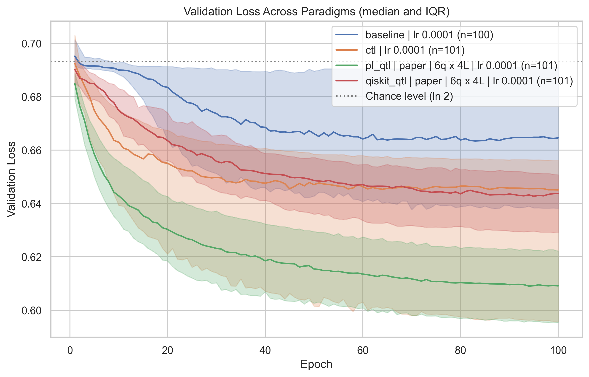
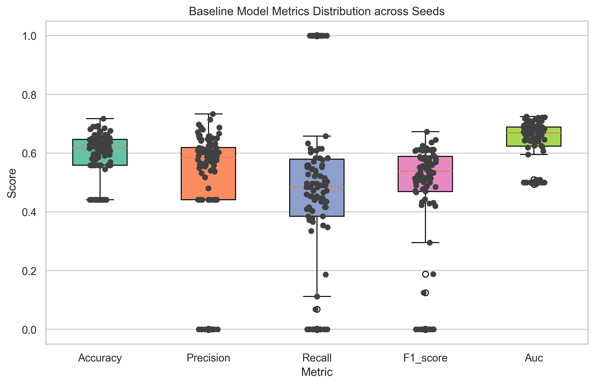
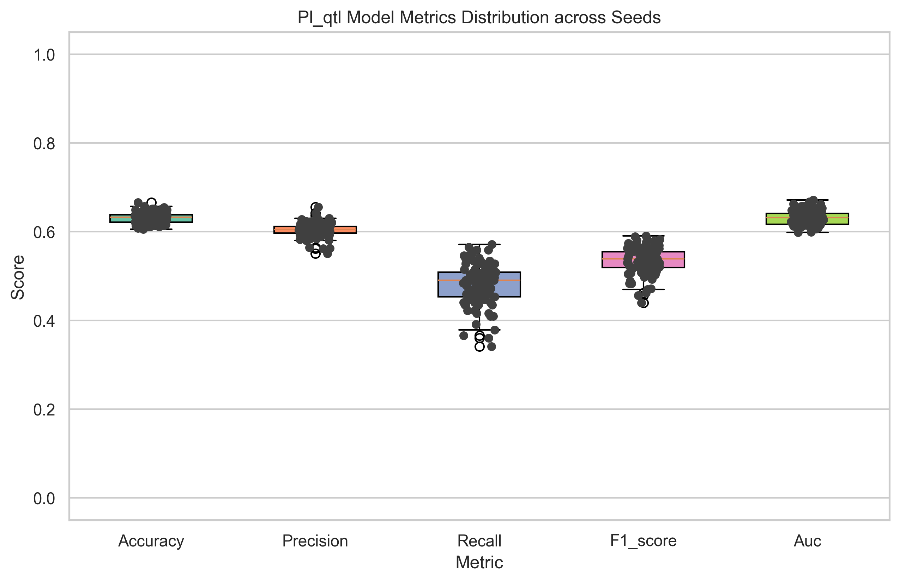
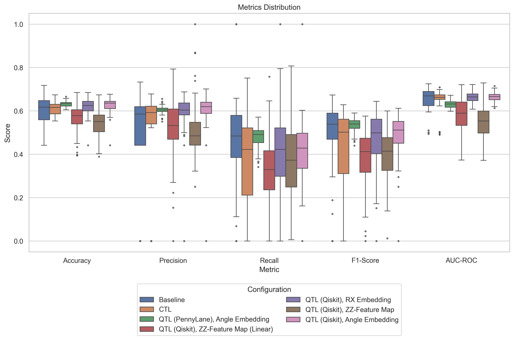
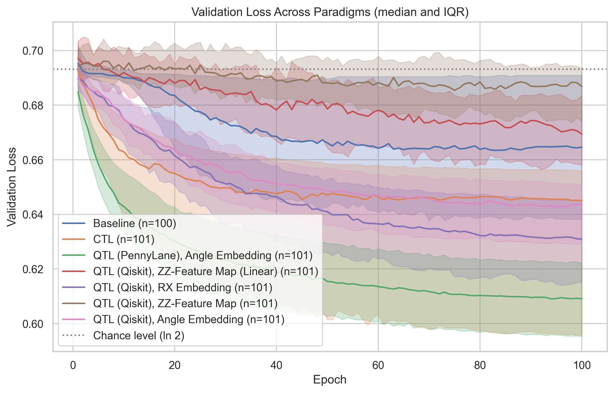

# Quantum Transfer Learning to Boost Dementia Detection

## Overview

This project reproduces and extends the foundational research on applying **Quantum Transfer Learning (QTL)** to the classification of Dementia from structural brain MRI scans (OASIS-II dataset), based on Bhowmik et al. (2025).

The core hypothesis is that a **Dressed Quantum Neural Network (DQNN)**, composed of a classical pre-net for dimensionality reduction, a Parameterized Quantum Circuit (PQC / Ansatz) for feature processing in Hilbert space, and a classical post-net for logit output, improves performance and reduces the variance across seeds when transferring features from a "weak" or suboptimal classical Convolutional Neural Network (CNN) backbone.

---

## Project Goals and Status

The 12-month plan (`docs/qtl_research_goals_activities.md`) has six activities: reproduce the paper's model (A1), implement alternative feature maps such as the $ZZ$-Feature Map (A2), optimise how the features are delivered to the circuit (A3), run on IBM quantum hardware (A4), measure noise resilience (A5), and write up the results (A6).

- **A1, done.** OASIS-II ETL with a deterministic patient-level split, the LeNet baseline, classical transfer learning (CTL), and the Dressed Quantum Network on PennyLane and Qiskit, each over 100 seeds. A Hadamard layer precedes the RZ embedding, because the circuit as drawn in the paper is a constant function (`docs/architecture.md`, section 3.1). Results below.
- **A2, in progress.** The RX embedding and the ZZ feature map (full and nearest-neighbour) run on the Qiskit head. Results below.

---

## Code Structure

The code under `src/dementia_boost` is split into layers with one responsibility each: `core` (seeds, run identity, file layout), `data` (ETL, split, loaders, feature cache), `models` (backbone and heads), `training`, `telemetry` (metrics, selection, report), and `viz` (all plotting). The scripts under `scripts/` are entry points. [docs/architecture.md](docs/architecture.md) describes each layer, the circuits and their mathematics, and the evaluation protocol.

---

## Activity 1 Results

The numbers below come from 100 seeds per paradigm on one patient-level split of the OASIS-II subset (76 training, 19 validation, and 41 test subjects; 698, 171, and 365 slices). Each paradigm has one configuration: learning rate 1e-4, 100 epochs, and for the quantum heads 6 qubits and 4 layers. The transfer-learning heads use the baseline backbone selected on validation. Every cell is the mean ± standard deviation across seeds, and the last three columns are the change of each paradigm's mean against the baseline's mean, in percent. The values come from `data/results/metrics/comparative_report.json`.

> [!IMPORTANT]
> **These results do not reproduce the base paper.** The paper reports 73.1% accuracy for the baseline, 86.4% for CTL, and 91.3% for QTL. Under the protocol used here, all four paradigms stay between 59% and 63% accuracy on test, and predicting the majority class (Nondemented) for every slice already gives 55.9%. We report the numbers as measured, and the next section lists the points where we deviate from the paper and why.

### Quantitative Comparison Across Paradigms

#### Test cohort (reference result)

The test cohort is never used for training, monitoring, or selection.

| Metric           | Baseline      | CTL           | PL QTL        | Qiskit QTL    | CTL $\Delta$ vs Baseline (%) | PL QTL $\Delta$ vs Baseline (%) | Qiskit QTL $\Delta$ vs Baseline (%) |
| :--------------- | :-----------: | :-----------: | :-----------: | :-----------: | :--------------------------: | :-----------------------------: | :---------------------------------: |
| **Accuracy**     | 0.595 ± 0.073 | 0.608 ± 0.031 | 0.632 ± 0.012 | 0.625 ± 0.032 |             +2.3             |              +6.3               |                +5.2                 |
| **Precision**    | 0.494 ± 0.219 | 0.494 ± 0.232 | 0.604 ± 0.016 | 0.607 ± 0.072 |             -0.1             |              +22.3              |                +22.8                |
| **Recall**       | 0.478 ± 0.284 | 0.356 ± 0.217 | 0.482 ± 0.045 | 0.416 ± 0.124 |             -25.6            |               +0.7              |                -13.0                |
| **F1-Score**     | 0.459 ± 0.209 | 0.398 ± 0.209 | 0.535 ± 0.030 | 0.485 ± 0.095 |             -13.4            |              +16.5              |                +5.6                 |
| **AUC-ROC**      | 0.639 ± 0.076 | 0.653 ± 0.045 | 0.632 ± 0.016 | 0.663 ± 0.020 |             +2.2             |               -1.1              |                +3.7                 |

#### Validation cohort (development result)

The validation cohort selects the backbone and monitors training, so these values are higher than a fresh cohort would give. They are shown to make that gap visible.

| Metric           | Baseline      | CTL           | PL QTL        | Qiskit QTL    | CTL $\Delta$ vs Baseline (%) | PL QTL $\Delta$ vs Baseline (%) | Qiskit QTL $\Delta$ vs Baseline (%) |
| :--------------- | :-----------: | :-----------: | :-----------: | :-----------: | :--------------------------: | :-----------------------------: | :---------------------------------: |
| **Accuracy**     | 0.628 ± 0.090 | 0.685 ± 0.077 | 0.758 ± 0.022 | 0.720 ± 0.048 |             +8.9             |              +20.7              |                +14.5                |
| **Precision**    | 0.575 ± 0.263 | 0.689 ± 0.342 | 0.831 ± 0.068 | 0.851 ± 0.129 |             +19.8            |              +44.7              |                +48.0                |
| **Recall**       | 0.511 ± 0.284 | 0.437 ± 0.243 | 0.607 ± 0.027 | 0.496 ± 0.129 |             -14.5            |              +18.9              |                 -2.9                |
| **F1-Score**     | 0.510 ± 0.229 | 0.511 ± 0.253 | 0.699 ± 0.017 | 0.610 ± 0.105 |             +0.2             |              +37.1              |                +19.6                |
| **AUC-ROC**      | 0.649 ± 0.088 | 0.739 ± 0.067 | 0.798 ± 0.016 | 0.767 ± 0.029 |             +13.8            |              +22.8              |                +18.1                |

The report also gives the percentage changes against CTL and between the two quantum heads. Relative changes of small, noisy means can look large (the recall of CTL is 0.356 ± 0.217), so read them next to the raw values and the spread.







### Key Observations & Findings

- **The paper's accuracies are not reproduced.** Test accuracy is 59.5% to 63.2% for all four paradigms, against 55.9% for always predicting the majority class, and AUC-ROC is 0.63 to 0.66. The gaps between paradigms are smaller than the baseline's spread across seeds (0.076), so with one split, one backbone, and 41 test subjects they are within the noise. Validation values are higher, as expected for the cohort that selects the backbone.
- **The baseline is unstable**: test accuracy ranges from 44% to 72% across seeds, and 15 of 100 runs predict a single class (recall 0 on test).
- **CTL is steadier, not better**: accuracy standard deviation falls to 0.031, the mean barely moves (+2.3%), recall falls (0.356), and 18 of 101 runs collapse to a single class.
- **QTL reduces the variance; the large gain does not reproduce**: PL QTL has the smallest spread on every metric (accuracy standard deviation 0.012) and no collapsed run (one on Qiskit). Precision rises (+22%) and accuracy slightly (+6.3%), but recall stays at the baseline level and AUC-ROC is not above CTL's. Part of the effect may come from the 6-dimensional bottleneck rather than the circuit; a classical head with the same bottleneck has not been run.
- **PennyLane and Qiskit agree on the means** (accuracy 0.632 and 0.625), but the Qiskit head has two to three times the spread and a higher final validation loss. It uses loss-level SPSA gradients (exact parameter-shift needs about 204 circuits per sample at 6 qubits and 4 layers), while PennyLane uses exact adjoint gradients, so the difference is mostly the gradient estimator.
- **Training had not converged at epoch 100**: the quantum heads' validation loss is still falling, possibly because of the learning rate (1e-4, decayed every 10 epochs), which has not been studied yet.

### Deviations from the Base Paper

We could not reproduce the paper's numbers with its description, and we changed two things that we found to be incorrect:

- **The circuit as drawn is a constant function.** Starting from the all-zero state, the paper's gate sequence (RZ, CNOT, CRY) never leaves that state up to a global phase, so every expectation value is 1 for all inputs and weights and the head can only learn a bias. We added a Hadamard layer before the embedding rotation (`docs/architecture.md`, section 3.1).
- **Models were chosen on the test set.** The paper picks the 6-qubit, 4-layer configuration because it had the highest test accuracy among 24, and reports the best-performing of several classical initialisations. We train on a train cohort, monitor and select on a separate validation cohort, and use the test cohort only to report. The split is by patient, deterministic, stratified by class, recorded in `split_manifest.json`, and checked whenever the data is loaded. We also report the mean and standard deviation over 100 seeds instead of the best run.

### Reproducing and Reading the Numbers

The scripts of the Quickstart reproduce every number above: the split is set by the constants of `scripts/etl_pipeline.py` (seed 42, test ratio 0.3, validation ratio 0.2, subjects `OAS2_0001` and `OAS2_0002` pinned to train), the backbone is the baseline with the best validation AUC-ROC (then F1, then lowest log loss), and `uv run scripts/list_runs.py` shows every configuration and run behind a table. The standard deviation is across seeds only; it does not include the uncertainty from the small test cohort, so it understates how much the numbers would move on a different split.

---

## Embedding Comparison (Qiskit only)

The embedding is the part of the circuit that loads the 6 scaled features into the qubits (`docs/architecture.md`, section 3.2, gives the mathematics). The Dressed Quantum Network above uses the paper's angle embedding. To see whether another embedding helps, the Qiskit head was also run with an RX embedding, the ZZ feature map (full entanglement, two repetitions), and a ZZ feature map with nearest-neighbour entanglement. The variational block, the backbone, the split, and every hyperparameter are the same, so the embedding is the only difference. Each configuration has 101 seeds (0 to 100).

> [!NOTE]
> **These embeddings were run only with the Qiskit head** (loss-level SPSA gradients). The PennyLane head has only been run with the angle embedding. The comparison is therefore between embeddings on one framework, and it says nothing about how the same embeddings would behave with PennyLane's exact gradients. The values come from the comparative report written for each configuration.

#### Test cohort

| Metric        | Angle Embedding | RX Embedding  | ZZ-Feature Map | ZZ-Feature Map (Linear) |
| :------------ | :-------------: | :-----------: | :------------: | :---------------------: |
| **Accuracy**  | 0.625 ± 0.032   | 0.618 ± 0.035 | 0.542 ± 0.056  | 0.572 ± 0.053           |
| **Precision** | 0.607 ± 0.072   | 0.596 ± 0.075 | 0.506 ± 0.114  | 0.530 ± 0.122           |
| **Recall**    | 0.416 ± 0.124   | 0.411 ± 0.169 | 0.371 ± 0.165  | 0.324 ± 0.146           |
| **F1-Score**  | 0.485 ± 0.095   | 0.467 ± 0.128 | 0.395 ± 0.115  | 0.382 ± 0.129           |
| **AUC-ROC**   | 0.663 ± 0.020   | 0.662 ± 0.023 | 0.548 ± 0.072  | 0.581 ± 0.075           |

#### Validation cohort

| Metric        | Angle Embedding | RX Embedding  | ZZ-Feature Map | ZZ-Feature Map (Linear) |
| :------------ | :-------------: | :-----------: | :------------: | :---------------------: |
| **Accuracy**  | 0.720 ± 0.048   | 0.702 ± 0.052 | 0.556 ± 0.067  | 0.610 ± 0.070           |
| **Precision** | 0.851 ± 0.129   | 0.839 ± 0.154 | 0.567 ± 0.161  | 0.675 ± 0.170           |
| **Recall**    | 0.496 ± 0.129   | 0.485 ± 0.163 | 0.393 ± 0.191  | 0.360 ± 0.170           |
| **F1-Score**  | 0.610 ± 0.105   | 0.585 ± 0.126 | 0.425 ± 0.145  | 0.438 ± 0.157           |
| **AUC-ROC**   | 0.767 ± 0.029   | 0.770 ± 0.027 | 0.574 ± 0.090  | 0.649 ± 0.090           |





- **RX matches the angle embedding.** Test AUC-ROC 0.662 against 0.663, with no seed-by-seed difference (RX better in 53 of 101 seeds; Wilcoxon signed-rank, p = 0.95). Accuracy is slightly lower (0.618 against 0.625), a gap detectable only on validation.
- **The ZZ feature map is worse, and more entanglement is worse.** Test AUC-ROC is 0.548 for the full map and 0.581 for the nearest-neighbour one. The full map beats the angle embedding in 8 of 101 seeds (p < 1e-15), and its validation loss stays near chance (ln 2) for all 100 epochs: the model barely trains.
- **A possible reason, not tested:** the ZZ angles $2(\pi - \tilde{z}_i)(\pi - \tilde{z}_j)$ span a wide range, so the encoded state may vary too sharply with the input for a 4-layer block trained with SPSA. The result may differ with exact gradients.
- **Scope.** One split, one backbone, 41 test subjects: in this setup a richer entangling encoding did not help, which does not show that it cannot help in general.

---

## Quickstart

### 1. Environment Setup

This project uses [`uv`](https://github.com/astral-sh/uv) to manage the dependencies, pinned in `uv.lock`:

```bash
uv sync
```

There is no need to activate the environment: run every script and tool through `uv run` (for example `uv run pytest`).

### 2. ETL and Split

```bash
# Raw NIfTI volumes to 2D slice tensors, split by patient into train / val / test,
# and data/results/split_manifest.json
uv run scripts/etl_pipeline.py

# Check that no patient is in more than one cohort (exit status 1 if one is)
uv run scripts/audit_cohorts.py
```

The split is set by the constants at the top of `scripts/etl_pipeline.py`: the seed, the test ratio (0.3), the validation ratio (0.2 of the non-test subjects), and `MANUAL_TRAIN_IDS` / `MANUAL_TEST_IDS`, which pin canonical subject IDs such as `OAS2_0001` to a cohort (an unknown ID, a visit ID, or an ID in both lists is rejected). The ETL is safe to rerun: it writes into a staging directory first, the same arguments reproduce the same files, and unusable subjects are listed with a reason in the manifest. The data loader refuses cohorts that do not match the manifest.

> [!IMPORTANT]
> **Evaluation protocol.** Models are trained on `train` and monitored on `val`, and every choice (such as the backbone of the transfer-learning heads) reads validation metrics only. The `test` cohort is never used to train or to choose; it is evaluated once per checkpoint and only reported.

### 3. Training

```bash
uv run scripts/training/train_baseline.py
uv run scripts/metrics/evaluate_baseline.py        # its validation metrics select the backbone
uv run scripts/training/train_ctl_multiseed.py     # heads on the backbone selected on validation
uv run scripts/training/train_pl_qtl_multiseed.py
uv run scripts/training/train_qiskit_qtl_multiseed.py

# Qiskit head with another embedding: paper (default), rx, zz_feature_map,
# zz_feature_map_linear; --seeds N runs only the first N seeds
uv run scripts/training/train_qiskit_qtl_multiseed.py --ansatz zz_feature_map
```

Each training script writes a checkpoint and a per-epoch history (with the full run specification) per seed and skips runs that already finished. The PennyLane head implements only the `paper` embedding (`docs/architecture.md`, section 3.2).

Runs are identified by hashes of their specification: `config_id` for a configuration (all its seeds), `run_id` for one seed, so changing any hyperparameter gives a new configuration that never overwrites an old one. Everything is written under `data/results/<kind>/<paradigm>/<config_id>/` (layout in `docs/architecture.md`, section 2.1.1). To look a hash up:

```bash
uv run scripts/list_runs.py                    # one row per configuration
uv run scripts/list_runs.py --runs             # one row per run
uv run scripts/list_runs.py --paradigm pl_qtl  # one paradigm only
uv run scripts/list_runs.py --find dc658242    # full spec and files of an ID prefix
uv run scripts/list_runs.py --runs --csv runs.csv
```

### 4. Evaluation, Report, and Figures

```bash
# val_results.json and test_results.json per configuration
uv run scripts/metrics/evaluate_ctl.py
uv run scripts/metrics/evaluate_pl_qtl.py
uv run scripts/metrics/evaluate_qiskit_qtl.py
uv run scripts/metrics/evaluate_qiskit_qtl.py --config <config_id>   # one configuration only

# Comparative report: mean and std across seeds on test, then validation, and the
# run selected on validation. A paradigm with several configurations needs --config.
uv run scripts/metrics/generate_improvement_report.py
uv run scripts/metrics/generate_improvement_report.py --config qiskit_qtl=<config_id> --output <file>

# Per configuration: metric distributions, ROC curves, confusion matrix
uv run scripts/viz/visualize_baselines.py
uv run scripts/viz/visualize_ctl.py
uv run scripts/viz/visualize_pl_qtl.py
uv run scripts/viz/visualize_qiskit_qtl.py

# Loss curves from the histories, and the metrics of all configurations side by side
uv run scripts/viz/visualize_loss.py
uv run scripts/viz/visualize_comparison.py
```

Options of the figure scripts:

- `--production` (comparison and loss): short presentation names, set in `src/dementia_boost/viz/display_names.py`, written as `*_production.png`.
- `--svg`, `--pdf` (all): also write the figures as vector files next to the PNGs (the loss script only for its comparison).
- `--exclude <config_id> ...` (comparison and loss): leave configurations out; the figures keep their names.

---

## References

1. **Bhowmik, S., Perciano, T., & Thapliyal, H. (2025).** _Quantum Transfer Learning to Boost Dementia Detection_. Proceedings of the Great Lakes Symposium on VLSI 2025, 849–853.
2. **Marcus, D. S. et al. (2007).** _Open Access Series of Imaging Studies (OASIS): Cross-sectional MRI Data in Young, Middle Aged, Nondemented and Demented Older Adults_. Journal of Computer Assisted Tomography, 31(6), 1498–1504.
3. Complete bibliography available in `docs/qtl_research_goals_activities.md`.
