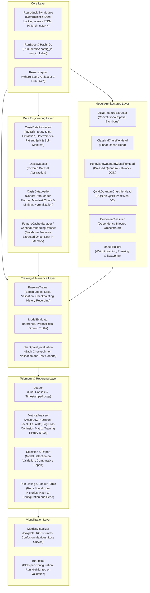
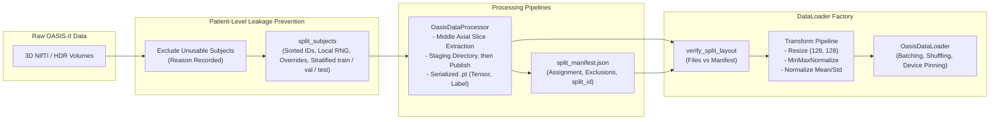
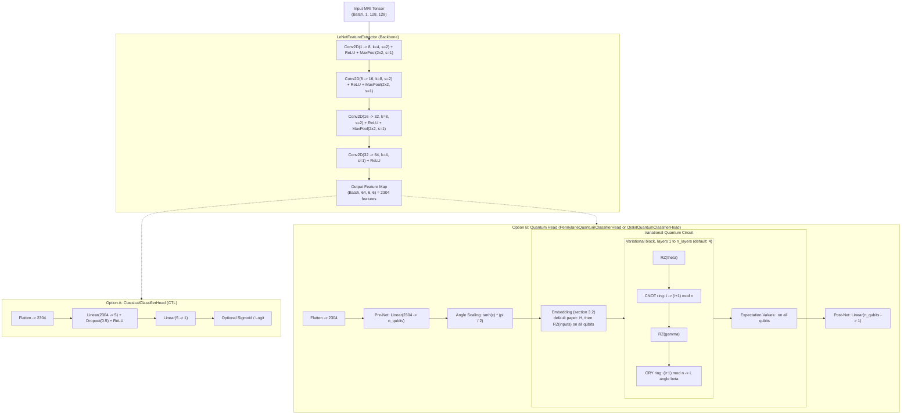
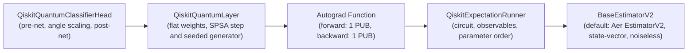
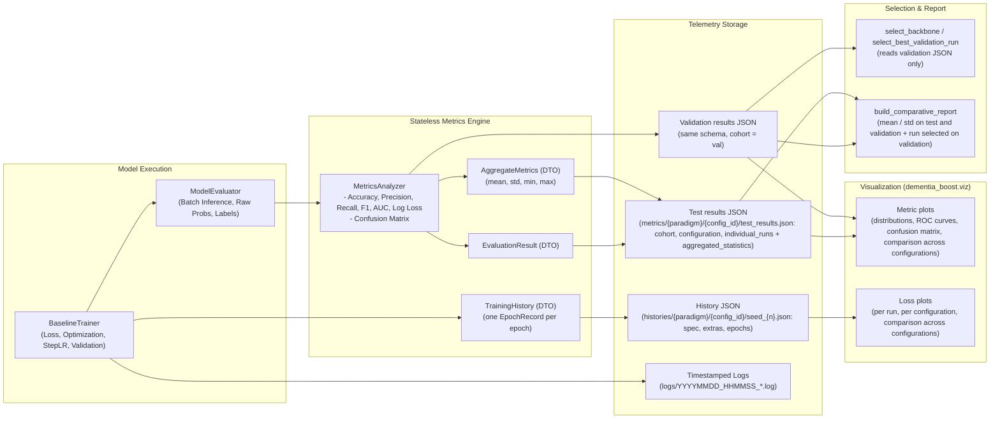

# System Architecture: Dementia-Boost QTL Framework

## 1. Architectural Overview

The code is split into six layers, each with one responsibility: data processing, model definitions, training, metrics and reporting, and plotting, on top of a core layer for seeds, run identity, and file layout.



---

## 2. Component Breakdown

### 2.1 Core Layer (`src/dementia_boost/core/`)

- **`reproducibility.py`**: Provides `set_seed(seed: int)`, which seeds Python's `random`, `numpy`, and PyTorch (CPU and CUDA), and sets `torch.backends.cudnn.deterministic = True` with `benchmark = False`.

- **`identity.py`**: The typed run specification `RunSpec`, the `Paradigm` enumeration, and the hash IDs and label derived from a spec (see 2.1.1).

- **`layout.py`**: `ResultsLayout`, the only code that knows where the artifacts of a run are written and read (see 2.1.1).

#### 2.1.1 Run identity

A run is not identified by a name, because a name says nothing about its qubits, layers, learning rate, backbone, or split, and two different configurations would collide on disk. Identity is split into three separate things:

- **The specification** (`RunSpec`, a frozen dataclass): the paradigm, the ansatz, qubits and layers, the learning rates, the `StepLR` settings, epochs, batch size, the gradient method, the `backbone_id`, the `split_id`, and the `seed`. Fields that do not apply to a paradigm are `None`, and each paradigm validates that its required fields are set (a baseline has no quantum fields and no backbone, a head needs its backbone). The spec is stored in every training history, so it is the source of truth for what a run was.
- **The IDs** (opaque hashes of the spec): `config_id` hashes every field except the seed, so all seeds of one configuration share it; `run_id` hashes every field. Both are the first 12 hex characters of a SHA-256 over the canonical JSON of the spec (sorted keys, `None` fields dropped, so adding a new optional field later does not change existing IDs). The `backbone_id` of a head is the `run_id` of the baseline it was built on, which pins its checkpoint and, through it, its split. `split_id` uses the same hash helper.
- **The label** (output only): a readable rendering such as `pl_qtl | paper | 6q x 4L | lr 0.0001 | seed 3`, for plots and logs. Nothing parses it.

No code recovers configuration from a file name. The trainer refuses a spec that disagrees with its optimizer's learning rate, its loader's batch size, or its `StepLR` settings, so an ID never names a configuration that did not run. Details that do not define a run (devices, evaluation cadence) are stored as non-hashed extras in the history.

`ResultsLayout` turns a spec into paths under `data/results`:

```
checkpoints/<paradigm>/<config_id>/seed_<n>.pt
histories/<paradigm>/<config_id>/seed_<n>.json     the history, which carries the full spec
histories/<paradigm>/<config_id>/config.json        the configuration (spec without the seed, label)
metrics/<paradigm>/<config_id>/{val,test}_results.json
plots/<paradigm>/<config_id>/
```

Seeds of one configuration share a directory, and a changed configuration gets its own, so runs never collide and the "skip a finished run" check (`ResultsLayout.is_done`) cannot skip a run whose configuration changed. `config.json` refuses to be overwritten by a different spec (a hash collision is detected, not merged). Runs are found by reading the histories (`telemetry/run_listing.py`), and a history that is not at the path its own spec gives is refused.

Because IDs are hashes, `uv run scripts/list_runs.py` gives the lookup: one row per configuration (label, split, seeds), one row per run with `--runs`, the full spec and file paths of any ID prefix with `--find`, and a CSV with `--csv`. It is rebuilt from the histories on every call.

### 2.2 Data Engineering Layer (`src/dementia_boost/data/`)

The data pipeline prevents patient-level leakage across longitudinal MRI sessions. Subjects (patients) are split into three cohorts, and every visit of a subject stays in that subject's cohort:

- **`train`** fits the models.
- **`val`** is evaluated every epoch for the loss curves, and is the only cohort used to choose between models (for example the backbone for transfer learning).
- **`test`** is never seen during training or selection. It is evaluated afterwards, once per saved checkpoint, and only reported.

The components that enforce this:

- **`subject_ids.py`**: One canonical subject ID form (`OAS2_NNNN`, uppercase, trimmed), kept apart from the visit ID (`OAS2_NNNN_MRk`, one exam of a subject). It maps diagnostic groups to labels case-insensitively, raises on a subject with conflicting groups, and validates the manual train and test overrides (unknown IDs, visit IDs, and IDs in both lists are rejected).

- **`split.py` (`split_subjects`)**: A pure function from labelled subjects, ratios, a seed, and the overrides to three sorted cohorts. It sorts the IDs before drawing and uses its own `random.Random(seed)`, so the same input gives the same split in every process and on every machine, and it never reads or reseeds global RNG state. Order of operations: overrides are fixed first, then the test cohort is drawn (default 30%), then the validation cohort from the remaining subjects that were not forced into train (default 20%). Both draws are stratified by class, so every cohort keeps the class balance of the whole set. It raises if a cohort would lack one of the classes.

- **`data_processor.py` (`OasisDataProcessor`)**: Scans the raw volumes (header only, checking that each is 3D), excludes the subjects that cannot be used, splits the rest with `split_subjects`, extracts the central 2D axial slice of every volume, and serializes the tensors (`.pt`). Subjects left out are recorded with a reason: no raw data, no row in the metadata CSV, no readable 3D volume, or the `Converted` group. The whole split is first written to a staging directory; only when every file was written does the processor replace the `.pt` files of `train/`, `val/`, and `test/` (other files in those directories are never touched) and write the manifest. An interrupted run therefore leaves the previous split intact. Running the ETL again is safe, and the same arguments reproduce the same files byte for byte.

- **`split_manifest.py`**: Writes and reads `split_manifest.json` (atomically, without timestamps). It records per subject its cohort, label, and file count; the excluded subjects with reasons; the skipped raw files; the seed, ratios, and manual overrides; and per cohort the subject count, file count, and class balance. `split_id` is a short hash of the subject-to-cohort assignment only, so it changes when and only when a subject changes cohort.

- **`split_guards.py` (`verify_split_layout`)**: Compares the cohort directories with the manifest and raises one `SplitIntegrityError` naming the offending subjects if a subject is in two cohorts, a file sits in a cohort the manifest does not assign to its subject, a subject has more or fewer files than recorded, or a cohort holds a single class. The processor runs it after writing, and the data loader runs it before returning any loader.

- **`cohort_audit.py`**: Read-only helpers that list the subjects of each cohort directory from the file names and report subjects shared between cohorts. `scripts/audit_cohorts.py` prints that report and exits with status 1 on a leak.

- **`dataset.py`**:

  - `OasisDataset`: Loads serialized `.pt` image-label pairs, listing the files in sorted order so sample order does not depend on the filesystem.

- **`data_loader.py`**:
  - `OasisDataLoader`: Factory creating PyTorch `DataLoader` instances over the processed NIfTI slice tensors for one cohort (`get_data_loader("train" | "val" | "test")`). Only the training loader shuffles. It verifies the layout against the manifest before returning a loader.
  - `MinMaxNormalize`: Per-sample min-max scaling to `[0.0, 1.0]`.

- **`embedding_cache.py`**:
  - `CachedEmbeddingDataset`: In-memory dataset of pre-extracted feature tensors and labels.
  - `FeatureCacheManager`: Extracts the backbone features once, caches them on disk, and builds in-memory `DataLoader`s for transfer learning.



---

## 3. Models and the Dressed Quantum Network (DQN)

Models are assembled by dependency injection: `DementiaClassifier` holds a `LeNetFeatureExtractor` backbone and a head, either a classical dense head or a variational quantum head.



### 3.1 Mathematical Formulation of the Dressed Quantum Network (DQN)

1. **Classical Feature Extraction**:
   $$z_{\text{raw}} = f_{\text{backbone}}(x) \in \mathbb{R}^{2304}$$

2. **Pre-Net Dimensionality Reduction & Angle Mapping**, with $n$ = `n_qubits`:
   $$\tilde{z} = \tanh(W_{\text{pre}} z_{\text{raw}} + b_{\text{pre}}) \cdot \frac{\pi}{2} \in \left[-\frac{\pi}{2}, \frac{\pi}{2}\right]^{n}$$

3. **Embedding**: the scaled features are loaded into a state $|\psi_e(\tilde{z})\rangle$ by the embedding $e$ (section 3.2). The default, `paper`, is the angle embedding:
   $$|\psi_{\text{paper}}(\tilde{z})\rangle = \bigotimes_{i=1}^{n} R_z(\tilde{z}_i)\, H\, |0\rangle = \bigotimes_{i=1}^{n} \tfrac{1}{\sqrt{2}}\left(e^{-i\tilde{z}_i/2}|0\rangle + e^{i\tilde{z}_i/2}|1\rangle\right)$$

4. **Variational block**, the same for every embedding. Layer $l = 1, \dots, L$ has weights $\theta_{l,i}, \gamma_{l,i}, \beta_{l,i}$ (the three rows of `weights[l]` in PennyLane, the three vectors of the flat weight in Qiskit):
   $$V_l = \Big[\prod_{i=0}^{n-1} \mathrm{CRY}_{(i+1) \bmod n \to i}(\beta_{l,i})\Big] \Big[\bigotimes_{i} R_z(\gamma_{l,i})\Big] \Big[\prod_{i=0}^{n-1} \mathrm{CNOT}_{i \to (i+1) \bmod n}\Big] \Big[\bigotimes_{i} R_z(\theta_{l,i})\Big], \qquad |\phi_{\theta}(\tilde{z})\rangle = V_L \cdots V_1\, |\psi_e(\tilde{z})\rangle$$
   Each product over $i$ is applied in increasing $i$ (the CNOT and CRY rings do not commute), and $\mathrm{CRY}_{c \to t}(\beta)$ rotates qubit $t$ about $y$ by $\beta$ when qubit $c$ is $|1\rangle$. There are $3Ln$ weights (72 at $n = 6$, $L = 4$), initialised uniformly in $[-\pi, \pi]$.

5. **Measurement**:
   $$\langle Z_i \rangle = \langle \phi_\theta(\tilde{z}) | Z_i | \phi_\theta(\tilde{z}) \rangle \in [-1, 1]$$

6. **Post-Net Classification Logit**:
   $$\hat{y}_{\text{logit}} = W_{\text{post}} \begin{bmatrix} \langle Z_1 \rangle \\ \vdots \\ \langle Z_n \rangle \end{bmatrix} + b_{\text{post}}$$

> [!IMPORTANT]
> **The Hadamard layer is not in the paper's figure.** Starting from $|0\rangle^{\otimes n}$, the gate sequence of Bhowmik et al. (2025) (RZ, CNOT, CRY) never leaves the set of states equal to $|0\rangle^{\otimes n}$ up to a global phase: RZ only adds a phase, CNOT fixes the state, and CRY never fires because its control stays in $|0\rangle$. Every $\langle Z_i\rangle$ would then be 1 for all inputs and weights, the pre-net and circuit weights would get zero gradient, and the head would only learn a bias. Preparing each qubit in $|+\rangle$ first turns the embedding angle into a relative phase, so the output depends on the inputs and the weights. Regression tests on both the PennyLane and the Qiskit circuits fail if any $\langle Z_i\rangle$ becomes constant or the gradients vanish.

### 3.2 Embeddings (Feature Maps)

The embedding is the `ansatz` field of the run specification, so each embedding is its own configuration with its own `config_id`; `paper` is the default and the name inside every existing configuration ID. The PennyLane head implements only `paper`; the Qiskit head implements all of the embeddings below (see 3.4 for how).

- **`paper` (angle embedding, formula in 3.1).** Each qubit sits on the equator of the Bloch sphere at azimuth $\tilde{z}_i$. A product state, so the embedding creates no correlation between features. $n$ angles.

- **`rx`.** Every qubit is rotated about $x$ from $|0\rangle$, with no Hadamard:
  $$|\psi_{\text{rx}}(\tilde{z})\rangle = \bigotimes_{i=1}^{n} R_x(\tilde{z}_i)\, |0\rangle = \bigotimes_{i=1}^{n} \left(\cos\tfrac{\tilde{z}_i}{2}|0\rangle - i \sin\tfrac{\tilde{z}_i}{2}|1\rangle\right)$$
  The feature sets the polar angle of each qubit, so $\langle Z_i\rangle = \cos\tilde{z}_i$ before the variational block. Also a product state. $n$ angles.

- **`zz_feature_map`.** The ZZ feature map of Havlicek et al. as implemented by Qiskit's `ZZFeatureMap` (full entanglement, 2 repetitions). One repetition applies Hadamards, a phase on every qubit, and a $ZZ$ phase on every pair, with the pair angle a product of two features:
  $$U_{\Phi}(\tilde{z}) = \exp\Big(-i \sum_{(i,j)\in E} (\pi - \tilde{z}_i)(\pi - \tilde{z}_j)\, Z_i Z_j\Big)\, \exp\Big(-i \sum_{i} \tilde{z}_i Z_i\Big), \qquad |\psi_{\text{zz}}(\tilde{z})\rangle = \big(U_{\Phi}(\tilde{z})\, H^{\otimes n}\big)^{2} |0\rangle^{\otimes n}$$
  with $E$ every pair $i < j$ (15 pairs at $n = 6$). In gates, $\exp(-i \tilde{z}_i Z_i) = R_z(2\tilde{z}_i)$ and $\exp(-i \phi\, Z_i Z_j) = R_{zz}(2\phi)$, so the angles are $2\tilde{z}_i$ and $2(\pi - \tilde{z}_i)(\pi - \tilde{z}_j)$: $n + n(n-1)/2 = 21$ angles. Qiskit writes the same gates as $P$ and CNOT, $P$, CNOT; they differ from $R_z$ and $R_{zz}$ only by a global phase, so every $\langle Z_i\rangle$ is identical (checked numerically against `ZZFeatureMap`: state fidelity 1). The state is entangled, and each pair of features enters through a product term. The pair angles reach about $2(3\pi/2)^2 \approx 45$ rad, so the map is a very sensitive function of the inputs.

- **`zz_feature_map_linear`.** The same map with $E = \{(i, i+1)\}$, nearest neighbours only: 5 pairs and $n + (n-1) = 11$ angles at $n = 6$.

### 3.3 PennyLane Execution Path

`resolve_quantum_device` (`pennylane_circuit.py`) picks the simulator: `lightning.qubit` by default, `default.qubit` as a fallback, or an injected device, which the heads and `builder.py` accept as `quantum_device`. Gradients are exact (adjoint). At 6 qubits the state has $2^6 = 64$ amplitudes, so CPU simulation is faster than the GPU simulator (`lightning.gpu`), whose memory transfers and kernel launches dominate at this size.

### 3.4 Qiskit Execution Path

`QiskitQuantumClassifierHead` is an independent, interchangeable counterpart of `PennylaneQuantumClassifierHead`. It uses the same pre-net, angle scaling, ansatz, and post-net, but runs the circuit through Qiskit Primitives V2, hand-written against `BaseEstimatorV2` with no `qiskit-machine-learning` dependency.



- **`qiskit_embeddings.py`**: The registry of embeddings (section 3.2). Each entry has a PyTorch angle function from $\tilde{z}$ to the gate angles, the number of angles, and the gates that consume them, one circuit parameter per angle. Computing the angles outside the circuit keeps every circuit parameter a plain input column (no products of run-time parameters in the simulator), and autograd differentiates the angle function exactly back to the pre-net. The head applies the angle function after the $\tanh$ scaling, so `QiskitQuantumLayer` only sees the angle columns.
- **`qiskit_blocks.py`**: The registry of variational blocks. Each entry creates its weight `ParameterVector`s, in the order of the layer's flat weight tensor, and appends one layer of gates. Only `paper`, the block of section 3.1, is registered so far; its weights are laid out as `[theta, gamma, beta]`, which saved checkpoints rely on.
- **`qiskit_circuit.py` (`build_qiskit_ansatz`)**: Builds the `QuantumCircuit` (the chosen embedding followed by `n_layers` layers of the chosen variational block), the input and weight `ParameterVector`s, and the per-qubit Pauli-Z `SparsePauliOp` observables. Pauli strings are reversed relative to the qubit index because Qiskit orders them from the most significant qubit.
- **`qiskit_runner.py`**: `QiskitExpectationRunner` owns only "circuit, observables, parameter batch in, expectation values out". Each call is one broadcast PUB with parameters shaped `(N, 1, P)` and observables shaped `(1, n_qubits)`, so every state is evolved once and all expectation values are read from it. `resolve_qiskit_estimator` is the Qiskit counterpart of `resolve_quantum_device`: it returns an injected estimator or, by default, Aer's `EstimatorV2` on the state-vector method with no noise model attached. `StatevectorEstimator` is the slower reference implementation and is injected explicitly where a reference is wanted, such as unit tests. Controlled rotations (`cry`, `crz`, `cp`) are decomposed once at construction, because qiskit-aer 0.17.2 evaluates them wrongly when their angle is bound at run time.
- **`qiskit_layer.py`**: `QiskitQuantumLayer` holds the flat weight vector, laid out as `[theta, gamma, beta]`, and a custom `torch.autograd.Function`. The backward pass is a loss-level SPSA estimate: one Rademacher direction per sample is shared by all outputs by folding the upstream gradient into the finite difference, which costs one PUB of `2 * Batch` states. The directions come from a generator seeded with the run seed, so a seed reproduces its gradient noise. Exact parameter-shift is avoided because it needs 204 shifted circuits per sample at the default 6-qubit, 4-layer depth.
- **`qiskit_heads.py` & `builder.py`**: Accept an optional `estimator` (and, on the head, `spsa_epsilon` and `seed`), so the backend is configuration rather than code.
- **`train_qiskit_qtl_multiseed.py`**: Records the gradient method and SPSA step in each run's spec (they change the maths, so they are part of the configuration ID) and the estimator class as a non-hashed extra in the history.

---

## 4. Transfer Learning Pipeline

The baseline is trained first; CTL and the quantum heads are then built on its frozen backbone through `builder.py`. Every paradigm trains on the `train` cohort and is monitored on the `val` cohort. The `test` cohort appears only in the evaluation step, and nothing is chosen with it:

```mermaid
sequenceDiagram
    autonumber
    participant D as OASIS-II Dataset (train / val / test)
    participant Base as Classical Baseline CNN
    participant Eval as checkpoint_evaluation
    participant Sel as Selection (validation only)
    participant Cache as FeatureCacheManager
    participant CTL as Classical Transfer Learning (CTL)
    participant QTL as Quantum Transfer Learning (QTL)

    Note over Base: Step 1: Train End-to-End Baseline
    D->>Base: Train LeNet Feature Extractor + Classical Dense Head on train, monitor on val
    Base-->>Base: Save last-epoch weights (checkpoints/baseline/config_id/seed_n.pt)

    Note over Eval,Sel: Step 2: Evaluate Every Checkpoint, Select on Validation
    Base->>Eval: Evaluate each baseline checkpoint on val and on test
    Eval-->>Sel: Validation metrics (metrics/baseline/config_id/val_results.json)
    Eval-->>Eval: Test metrics (test_results.json), reported only
    Sel-->>Base: Backbone spec with the best validation AUC-ROC (then F1, then lowest log loss); its run_id becomes the heads' backbone_id

    Note over Cache: Step 3: Extract & Cache Invariant Embeddings
    Base->>Cache: Load selected backbone weights & Freeze parameters
    D->>Cache: Extract train & val spatial embeddings (2304-dim)
    Cache-->>Cache: Keep the features in memory

    Note over CTL,QTL: Step 4: Train the Heads on the Cached Features
    Cache->>CTL: Stream in-memory feature batches (Seeds 0..100)
    CTL->>CTL: Initialize Dense Head (Glorot Uniform) & Train directly on embeddings
    CTL-->>Base: Assemble full DementiaClassifier and save checkpoint

    Cache->>QTL: Stream in-memory feature batches (Seeds 0..100)
    QTL->>QTL: Optimize Dressed Quantum Network (Pre-Net + VQC + Post-Net)
    QTL-->>Base: Assemble full DementiaClassifier and save checkpoint

    Note over Eval: Step 5: Evaluate CTL and QTL checkpoints on val and test, then report
```

---

## 5. Telemetry, Metric Aggregation & Evaluation Flow

Training and evaluation lifecycles are decoupled from serialization and plotting:



Evaluation, selection, and reporting follow one protocol: choices are made on validation, and results are reported on test first.

- **Evaluation.** `evaluate_paradigm` (`checkpoint_evaluation`) finds the finished runs of a paradigm through their histories, builds each configuration's model from its own spec, evaluates every checkpoint once on `val` and once on `test`, and writes `metrics/<paradigm>/<config_id>/{val,test}_results.json`. Each file carries a `cohort` marker and the `configuration` (ID, label, spec without the seed).
- **Selection.** `select_best_validation_run` and `select_backbone` (which resolves the best baseline to its spec) accept only a file marked `val` and rank by validation AUC-ROC, then F1, then lowest log loss, then run ID; anything else raises, so test metrics never decide a choice. The run highlighted in the isolated ROC curve and confusion matrix is the one selected on validation.
- **Report.** `build_comparative_report` (`scripts/metrics/generate_improvement_report.py`) takes one configuration per paradigm (the only one with results, or one named with `--config`) and refuses paradigms trained on different splits. It leads with the mean and standard deviation across seeds on test and the test metrics of the run selected on validation, then gives the same statistics on validation, and the percentage changes between the means of each cohort (`comparisons.test`, `comparisons.validation`). The measured results are in the README.
- **Histories.** `BaselineTrainer` only sees the train and validation loaders, so the per-epoch `val_loss` and `val_acc` are validation values. It records a `TrainingHistory` and writes it to JSON (every `history_save_every` epochs, default 10, and on exit, atomically), and never plots. The plotting steps live in `dementia_boost.viz` (`run_plots`, `MetricsVisualizer`); the scripts under `scripts/viz` are thin callers.

---

## 6. Directory and Module Structure

```
dementia-boost/
├── docs/                                  # Research documentation and specifications
│   ├── architecture.md                    # System architecture and technical overview
│   ├── qtl_research_goals_activities.md   # 12-month research schedule and activities
│   └── qtl_to_boost_dementia_detection.md # Foundational paper (Bhowmik et al. 2025)
├── src/dementia_boost/
│   ├── core/                              # Seeds, run identity (RunSpec, hash IDs), results layout (section 2.1)
│   ├── data/                              # ETL, patient-level split, manifest, guards, loaders, feature cache (2.2)
│   ├── models/                            # Backbone, classical and quantum heads, builder (3)
│   │   ├── classical_cnn/                 # LeNet backbone, classical head, DementiaClassifier
│   │   └── quantum_cnn/                   # PennyLane and Qiskit circuits, heads, embeddings, runner (3.3, 3.4)
│   ├── training/                          # Trainer, evaluator, evaluation of every checkpoint (4, 5)
│   ├── telemetry/                         # Metrics, histories, run listing, selection, report, logger (5)
│   └── viz/                               # All plotting code; the viz scripts only call it (5)
├── scripts/                               # Entry points, all run with uv run
│   ├── etl_pipeline.py, audit_cohorts.py  # Build the split; check that no subject is in two cohorts
│   ├── list_runs.py                       # Look up configurations and runs by hash ID
│   ├── training/                          # One multi-seed training script per paradigm
│   ├── metrics/                           # One evaluation script per paradigm, comparative report
│   └── viz/                               # One plotting script per paradigm, loss and comparison figures
└── tests/                                 # Unit and integration tests
```
